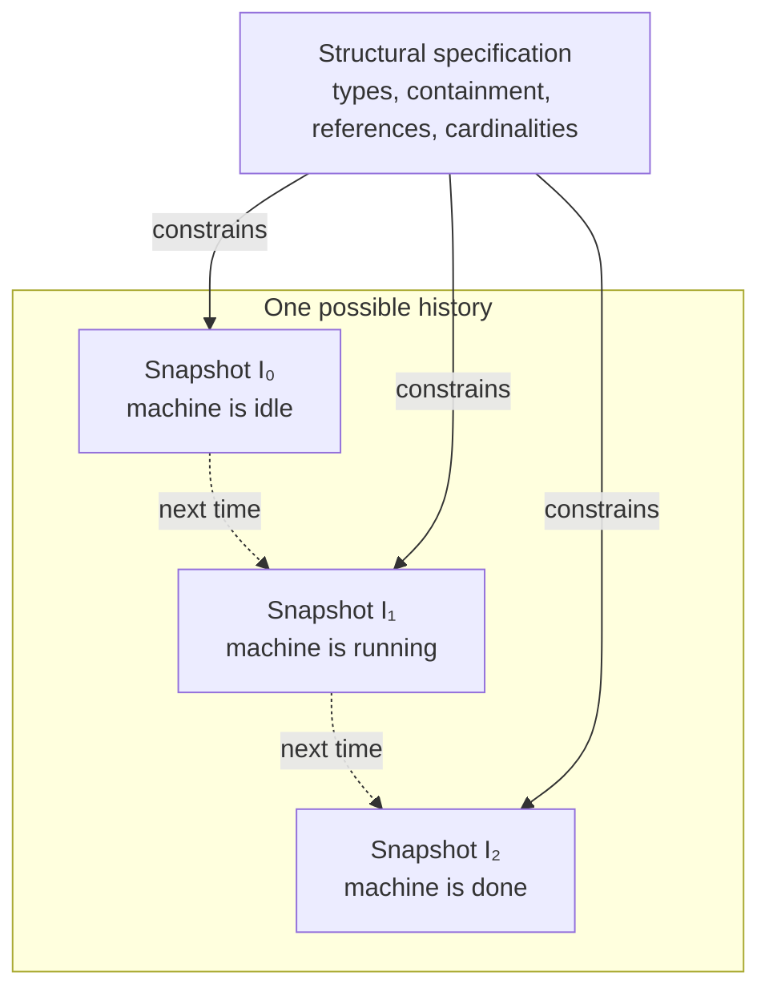
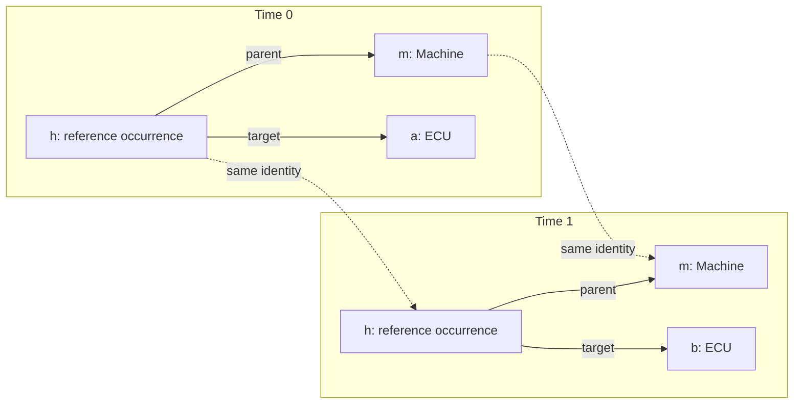
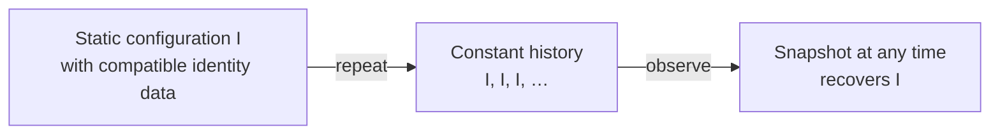
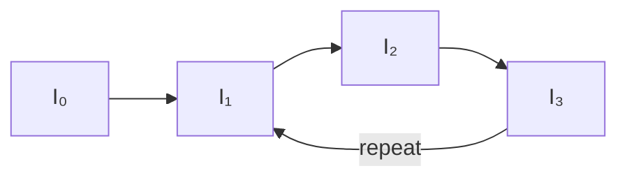

# From structure to behavior

<!-- [impl->req~public-foundation~1] -->

**Structural Clafer describes which worlds are possible. Behavioral Clafer
describes which histories of those worlds are possible.** A world can change
while retaining identifiable objects, relationships, and obligations. The
structural semantics makes each world precise; the temporal semantics constrains
its evolution.

The central connection is between legal snapshots, shared identities, and
temporal obligations. Category theory organizes structural diagrams and their
interpretations. Temporal logic expresses conditions over histories of those
interpretations. These two perspectives fit together without requiring every
change of state to be a structure-preserving morphism.

The explanation below uses the repository's [corrected behavioral profile](behavioral-profile.md),
including reappearance, captured identities with current navigation, and
parent-lifetime cancellation. The [structural source](sources.md#primary-source)
is the SoSyM paper, especially §6 and Appendix 2; the
[behavioral source](sources.md#behavioral-profile-sources) is *Clafer: Lightweight
Modeling of Structure, Behaviour, and Variability*, especially §5 Definitions
1–5 and §6.1. The focused contracts linked below own the exact definitions and
source departures.

## Legal configurations and legal histories

One structural specification constrains every snapshot in a behavior:

The arrows from the specification express structural conformance. The dashed
arrows express temporal succession. The diagram does not identify the latter
with structural morphisms.

Let $D$ be a structural specification. Write $\mathcal C(D)$ for its collection
of legal structural configurations:

$$
\mathcal C(D)=\lbrace I\mid I\models_{\mathrm{str}}D\rbrace.
$$

Adding behavioral constraints $\Phi$ selects histories:

$$
\mathrm{Behaviors}(D,\Phi)
=\lbrace\tau\mid \mathrm{Coherent}(\tau)
  \land (\forall t,\ I_t\in\mathcal C(D))
  \land \tau\models\Phi\rbrace.
$$

This is a conceptual decomposition: coherence retains identity, type and parent
information across time; each snapshot satisfies the chosen structural profile;
and $\Phi$ collects the attached constraints and temporal modifier obligations.
Exact agreement with the historical structural formalization is restricted to
the [common fragment](behavioral-qualification.md#exact-static-common-fragment).

A trace is a **sequence**, not a set of snapshots. Order and repetition matter.
An ordered sequence of individually legal configurations is still insufficient:
the same identity cannot acquire a different type or containment parent merely
because both configurations would be legal in isolation.

## States can be ordinary nested objects

Consider a machine with exactly one active state: Idle, Running, or Done. These
states can be ordinary nested clafers. At one instant the machine has an Idle
child; at another it has a Running child. The machine remains an instance of
the same Machine declaration.

- Containment expresses that a state belongs to a machine.
- A group cardinality expresses that exactly one state is active.
- Presence expresses which state is active now.
- Temporal constraints express how active states may change.

The machine does not change its type from Idle to Running. Its nested structure
changes. The three structural configurations can all be legal without requiring
the order Idle → Running → Done. Temporal constraints can select that order,
prohibit returning to Idle, or require eventual completion.

This also connects variability and behavior. Structural variability describes
alternative configurations. Behavioral variability describes alternative
histories. A feature choice intended to remain fixed during a product's life
needs the appropriate temporal stability constraint; cardinality alone does not
express stability.

## What time adds to a structure

A convenient presentation of the underlying trace data is:

$$
\tau=(U,\mathrm{type},\mathrm{parent},L,R).
$$

| Component | Meaning |
| --- | --- |
| $U$ | A shared universe of object identities |
| $\mathrm{type}(x)$ | The fixed direct declaration of identity $x$ |
| $\mathrm{parent}(x)$ | Its fixed actual containment parent, except for the root |
| $L_t\subseteq U$ | The identities present at time $t$ |
| $R_t$ | The reference relationships at time $t$, with their declaration views |

Time is discrete: $t=0,1,2,\ldots$. It supplies an order and a next instant,
without assigning seconds, durations, or a scheduling policy. Presence and
reference targets vary with time; direct type and actual parent are fixed.
Additional temporal modifiers can require some of the varying data to remain
stable.

At each time, inherited declaration extents include the live identities whose
direct types refine those declarations. Containment relates live children to
their fixed live parents. References must satisfy their endpoint typing,
presence, totality and uniqueness obligations. An invalid reference to an absent
target makes the trace invalid; ignoring that edge does not repair the trace.

The snapshot's carrier is $L_t$, rather than the entire pool $U$. An unused or
currently absent identity is not an object of that snapshot. The synthetic root
is always present. See the [trace and snapshot contract](behavioral-traces.md).

An identity may have several lifetimes, separated by absence, while keeping its
type and parent. A replacement object has a different identity even if it looks
the same. Two isomorphic snapshot diagrams can therefore conceal a replacement
that matters to a formula remembering the original object. Names and diagram
layout cannot supply the identity correspondence.

## Reference occurrences persist while targets change

The span-shaped view from the structural semantics remains useful:

$$
\mathrm{ParentObjects}_t
\xleftarrow{\ \mathrm{parent}\ }
\mathrm{ReferenceHeads}_t
\xrightarrow{\ \mathrm{target}_t\ }
\mathrm{TargetObjects}_t.
$$

The middle objects retain reference-occurrence identity. Consider an occurrence
$h$ owned by machine $m$, changing its target from ECU $a$ to ECU $b$:

Both ECUs exist throughout; only the selected target is shown in each panel.
The occurrence $h$ and its parent $m$ remain the same objects. The structural
semantics checks that each selected target is legal. Temporal constraints can
permit the change, prohibit it, or require it under a condition.

Two bag-reference heads at one parent and target are still two occurrences.
Replacing their identities with their common target loses multiplicity and the
ability to follow their individual evolution. Groups count child heads, not the
number of distinct dereferenced targets.

This distinction also explains the corrected reference modifiers. `finalref`
fixes each head's reference during that head's uninterrupted life. `finaltarget`
fixes the parent's target image during the parent's life: two heads can swap
targets while preserving that image. `final` fixes heads and their references;
its effect is shallow, so it does not recursively freeze every descendant.
The [modifier contract](behavioral-surface.md#modifiers-and-anchors) gives the
precise lifetime boundaries and inherited obligations.

## Environments remember objects across snapshots

The trace describes the world. An environment accompanies a particular
evaluation of a formula:

$$
\tau,t,\rho\models\varphi.
$$

This asks whether $\varphi$ holds in trace $\tau$, starting at time $t$, with
bindings $\rho$. Many evaluations can occur at the same instant with different
environments. There need not be one environment stored beside each snapshot.

A quantifier captures an identity; a set binding captures an evaluated set of
identities. Advancing time retains those values. Navigation reads the current
relationships. In the reference example, suppose that time 0 captures
$x=\{h\}$ and $y=\mathrm{target}_0(x)=\{a\}$. At time 1:

| Expression | Result |
| --- | --- |
| $x$ | Still $\{h\}$ |
| Current target of $x$ | Now $\{b\}$ |
| $y$ | Still $\{a\}$ |

Capturing the head remembers which reference was selected. Capturing its target
remembers which target it had when selected. An absent identity can remain in a
captured set; remembering an object does not assert its current presence. A
newer instance of the same declaration does not replace the captured identity.

Under a persistent attachment, compare these formulas, with quantifiers ranging
over the currently present machines:

$$
\exists x\;G\,\mathrm{online}(x)
\qquad\text{and}\qquad
G\,\exists x\;\mathrm{online}(x).
$$

The first chooses one identity now and requires that identity to remain online.
The second permits a different witness at each time. Two machines alternating
availability can satisfy the second without satisfying the first.

The [environment contract](behavioral-formulas.md#captured-values-and-current-navigation)
also distinguishes observed standalone `this`, which is live-filtered, from
direct navigation starting at the fixed attachment identity. Captures and
attachment are separate: binding a variable never moves the formula to that
variable's object.

## Containment bounds temporal obligations

Suppose a constraint attached to a Running state says that its machine eventually
reaches Done. The obligation should survive disappearance of that Running state.
Otherwise, leaving Running for the wrong state could evade the promise.

The corrected semantics retains the original attachment and bounds its temporal
obligation by the attachment's **parent's uninterrupted lifetime**. For a state
nested directly in a machine, that parent is the machine. A possible history is:

| | Time 0 | Time 1 | Time 2 | Time 3 |
| --- | --- | --- | --- | --- |
| Parent machine $m$ | Present | Present | Absent | Present again |
| Attached state $r$ | Present | Absent | Absent | Present again |
| Done | Absent | Absent | Absent | Absent |
| Obligation begun at 0 | Started | Still owed | Cancelled | Remains cancelled |
| New obligation from $r$ | — | — | — | Started |

At time 1 another state, such as Idle, can satisfy the structural group rule
without fulfilling the outstanding promise. At time 2 the parent gap cancels
that promise. Reappearance starts new obligations; the old one never resumes.

Containment thus has two roles: it organizes objects and cardinalities within a
snapshot, and it supplies lifetime boundaries for obligations across snapshots.
Moving a constraint between nesting levels can change its meaning even when its
text is unchanged. Top-level objects have the permanent synthetic root as their
actual parent, so their attached obligations do not end merely because those
objects disappear.

Let $P(j)$ mean that the original attachment's parent is present at time $j$.
For a currently live attachment, the operators have these meanings:

| Operator | Meaning within the current parent lifetime |
| --- | --- |
| $X_P\varphi$ | Require $\varphi$ next, if the parent remains present |
| $F_P\varphi$ | Require eventual $\varphi$, with parent termination discharging the obligation |
| $G_P\varphi$ | Require $\varphi$ throughout the remaining uninterrupted parent lifetime |
| $\varphi\,U_P\,\psi$ | Maintain $\varphi$ until $\psi$ or parent termination |

For until, parent termination does not excuse an earlier violation of the left
operand. With a permanently present parent, these operators have their ordinary
infinite-time meanings.

The bounded meanings can be expressed in ordinary temporal logic by making
parent presence explicit. For example:

$$
F_P\varphi\equiv F(\neg P\lor\varphi),
\qquad
G_P\varphi\equiv(P\land\varphi)\;W\;\neg P.
$$

Here $W$ is ordinary weak until. The second equation stops at the first parent
gap and does not restart upon reappearance. The
[attachment and cancellation contract](behavioral-formulas.md#attachment-and-cancellation)
states the exact interval meanings.

### When obligations begin

An ordinary attached constraint is evaluated at every applicable live instant.
At the permanent root, an unanchored $F p$ consequently requires:

$$
\forall t\;\exists j\geq t:\ p(j).
$$

This requires recurrence. Anchoring it `initially` instead asks for an occurrence
from the initial instant. For a nested attachment, `initially` checks each birth,
including time zero and each reappearance. `finally` checks each last live state;
a life that never ends has no final anchor. These anchors concern the
attachment's own life, while temporal cancellation concerns its parent's life.
See [anchors and attachment](behavioral-surface.md#transitions-and-attachment).

### Negation and defined observations

Cancellation affects the interpretation of source negation. The corrected source
semantics processes temporal polarity before inserting lifetime guards. For a
total atom `error`, source “not eventually error” has the bounded meaning
$G_P\neg\mathrm{error}$, rather than the classical complement of the already
bounded $F_P\mathrm{error}$.

If the parent ends without an error, the eventuality is discharged and “no error
during that lifetime” also holds. There is no contradiction in the underlying
logic: the source negation operator and classical negation of the whole
satisfaction judgment have different roles here. Assertions fail by classical
negation of their interpreted judgment. The
[signed formula contract](behavioral-formulas.md#signed-source-meaning-and-normalization)
defines the remaining polarity rules, including the special counting cases.

An observation must also be defined when the semantics requires it. A division
by zero, for example, does not become false merely by appearing inside a temporal
formula. The corrected partial semantics retains definedness separately from
truth, including all required observations over the active temporal interval.
The [partial-observation contract](behavioral-structure.md#captured-static-atoms-and-partial-temporal-composition)
specifies these obligations.

## How category theory and temporal logic fit together

The structural account organizes diagrams, sets of objects, spans of links,
mappings between specifications, and preservation or restriction of models.
Temporal logic supplies predicates over histories of those interpretations.
The structural organization remains useful at every time.

One must nevertheless choose what an arrow between snapshots means. In the
changing-reference example, an identity-preserving map that preserves the edge
from $h$ to $a$ cannot simultaneously describe replacing that edge by one from
$h$ to $b$. Births and deaths introduce further obstacles to using ordinary
total instance morphisms for all changes.

Temporal succession and structural morphisms are therefore different kinds of
arrows. A useful diagrammatic presentation connects the live carriers through
their shared identity universe:

$$
L_t\hookrightarrow U\hookleftarrow L_{t+1}.
$$

These embeddings identify the same objects across times. They do not assert
that every reference relationship is preserved. The intersection
$K=L_t\cap L_{t+1}$ gives the corresponding span of surviving identities:

$$
L_t\hookleftarrow K\hookrightarrow L_{t+1}.
$$

At this level, the arrows are maps of identity carriers. Rigid typing and
ownership agree on shared identities; references may change. These are useful
explanatory diagrams, not claims of full instance morphisms or of a newly
formalized category of transitions.

The bridge can thus be presented as **time-indexed structural interpretations
over shared identities**. A full categorical treatment of dynamics would require
an additional choice of transition objects and morphisms. The existing structural
category does not determine that choice. See the
[structural interpretation account](architecture.md#dpgraph-core-and-models).

## The correspondence that makes the bridge precise

Three principles connect the static and temporal meanings.

**Observing a legal behavior recovers a legal structure.** Each snapshot satisfies
the structural profile used to admit the trace. On the guarded common fragment,
this recovers the existing structural satisfaction judgment:

$$
\tau\models_{\mathrm{beh}}(D,\Phi)
\quad\Longrightarrow\quad
\forall t,\ \mathrm{snapshot}_t(\tau)\models_{\mathrm{str}}D.
$$

**A compatible static configuration can remain constant.** When there are no
additional temporal constraints or modifiers, a satisfying static configuration
with suitable identity and parent witnesses can be repeated forever:

The witnesses identify direct types and actual parents and give exact agreement
with inherited head extents and containment. Their existence is not inferred
from arbitrary structural satisfaction. Recovery is through the equivalence
between the live carrier and the original carrier. The
[snapshot contract](behavioral-traces.md#projection-and-constant-embedding)
and [common-fragment contract](behavioral-qualification.md#exact-static-common-fragment)
retain the well-formedness, support and effective-group conditions. Richer
behavioral structures are not automatically instances of the historical guarded
static fragment.

**Observations agree across the bridge.** For expressions in the shared domain,
with compatible environments and defined values, evaluating a static expression
in a snapshot agrees with evaluating its behavioral counterpart at that time.
Captured sets and absent identities need their explicit environment conditions;
they are not automatically admissible in the static evaluator. Temporal operators
then combine these observations across time. The
[static observation bridge](behavioral-structure.md#captured-static-atoms-and-partial-temporal-composition)
owns the exact agreement assumptions.

These correspondences preserve the structural foundation while explaining what
the temporal extension contributes: continuity of identity, memory through
environments, and obligations whose meaning depends on lifetimes.

## Finite pictures of infinite behavior

A finite diagram can denote an infinite history when it includes a repeating
loop, often called a lasso:

Its meaning is the infinite sequence $I_0,I_1,I_2,I_3,I_1,I_2,I_3,\ldots$.
This is different from stopping at $I_3$. The loop edge matters for births,
deaths and outstanding obligations. Repeating a stored snapshot does not itself
create a new birth; birth depends on presence in the actual preceding state,
with a separate rule at time zero.

Checking a supplied lasso can agree exactly with checking its infinite
unfolding under the stated finite-observation conditions. This does not imply
that every infinite behavior is a lasso or that failure to find a bounded
witness proves impossibility. The [finite verification contract](behavioral-verification.md)
separates the infinite meaning from its finite checking representation.
